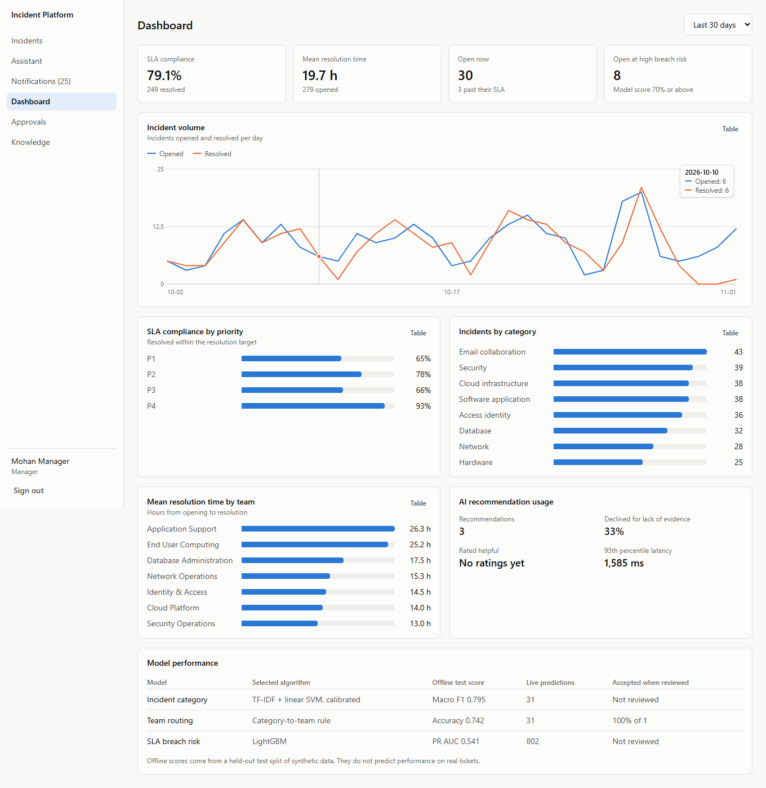
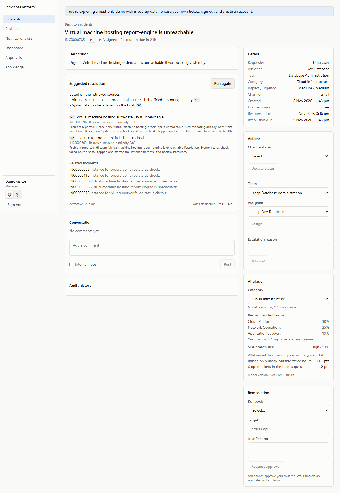
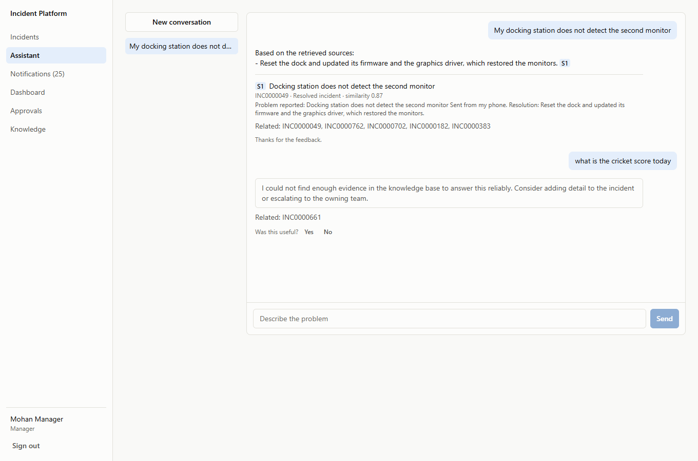
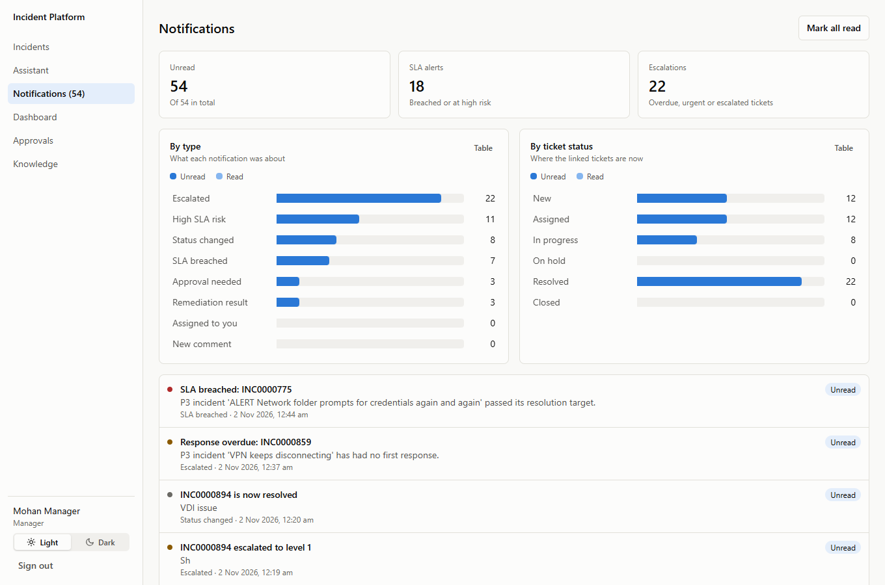
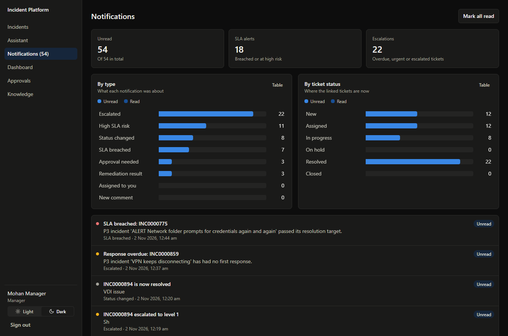
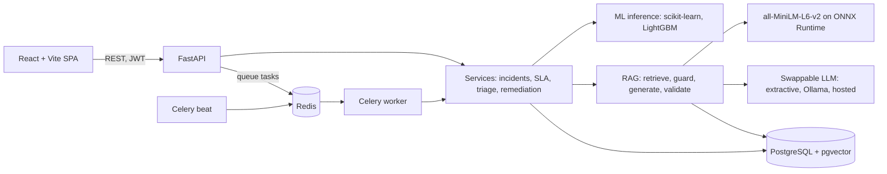

# Enterprise Incident Platform

An incident management system with ML triage and evidence-grounded troubleshooting. It covers the whole ticket lifecycle: raising, routing, SLA tracking, escalation, resolution, and approval-gated remediation. Models help at each stage, and people can override every one of them.

All demo data is synthetic. The SLA method is also benchmarked on a public, real incident log, because a score on self-generated data proves very little.

**Live demo:** <https://incident-platform-ql4e.onrender.com>. It runs on free hosting and sleeps when idle, so the first visit can take a while to load.



| Incident with cited resolution | Support assistant |
| --- | --- |
|  |  |

| Notifications, light | Notifications, dark |
| --- | --- |
|  |  |

## What it does

- **Incident management:** role-based access, assignment, an ITIL priority matrix, SLA clocks that pause on hold, escalation, filtering, and an append-only audit log enforced by a database trigger.
- **ML triage:** predicts the category and recommends a team, each with a confidence score, and records every human correction.
- **SLA risk:** estimates breach probability using only what is known when a ticket opens.
- **RAG troubleshooting:** retrieves knowledge articles and resolved incidents with pgvector, then answers with citations or declines when the evidence is weak.
- **Support assistant:** conversational troubleshooting, related incidents and suggested runbooks, limited to documents the user may read.
- **Automation:** Celery jobs for SLA checks, notifications, knowledge indexing and auto-close, plus remediation that needs a second person's approval.
- **Notifications:** personal alerts with unread and read counts charted by type and by ticket status.
- **Analytics:** volume, SLA compliance, resolution time, live model acceptance and AI usage, all computed from stored records.
- **Light and dark themes:** follows the system setting until you choose, and remembers the choice.

## Architecture



See [docs/ARCHITECTURE.md](docs/ARCHITECTURE.md) for the schema, access model and tradeoffs.

## Results

Every figure is generated by the code in this repository and stored in [docs/metrics/](docs/metrics/). [docs/EVALUATION.md](docs/EVALUATION.md) has the method and the commands to reproduce them.

**Real data: the leakage-safe method on the public UCI incident log (23,362 incidents)**

| Model | ROC-AUC | PR-AUC |
| --- | --- | --- |
| Leakage-safe, features known at opening | **0.707** | **0.439** (base rate 0.238) |
| Same data with post-outcome fields, deliberately | 0.985 | 0.974 |

The leaky row is the score a careless pipeline would report. The breach rate in this log also falls from 64% to 24% in a month, and the model's ranking survives that but its probabilities do not, so a real deployment needs drift monitoring and recalibration.

**Synthetic data: the served models (13,000 deduplicated tickets, chronological test split)**

| Task | Selected model | Test result | Baseline |
| --- | --- | --- | --- |
| Category (8 classes) | TF-IDF + calibrated linear SVM | Macro F1 **0.795**; **0.708** on unseen phrasing | 0.029 (majority class) |
| Team routing (7 teams) | Category-to-team rule | Accuracy **0.742**, top-3 0.949 | Rule beat text ML on validation |
| SLA breach risk | LightGBM | ROC-AUC **0.756**, PR-AUC **0.541** | PR-AUC 0.240 (base rate) |

**RAG: 132 synthetic articles, 67 answerable and 18 unanswerable hand-written test questions**

| Measure | Vector search | TF-IDF keyword baseline |
| --- | --- | --- |
| Recall@3 | **0.955** | 0.888 |
| MRR | **0.926** | 0.886 |

Answered 63 of 67 answerable questions with 89% citation correctness, and refused 18 of 18 unanswerable ones. Retrieval takes 37 ms at the median on a laptop CPU. The questions come from the same author as the articles, so treat these as a sanity check, not a benchmark.

Synthetic scores measure the pipeline. They do not predict performance on real tickets.

## Run it

### With Docker

```bash
cp .env.example .env     # then replace every "change me" value
docker compose up --build
```

Open <http://localhost:8080>. The first start trains the models and downloads the embedding model, so it takes a few minutes and several GB of disk.

### Without Docker

On Windows without Docker, follow [docs/LOCAL_SETUP.md](docs/LOCAL_SETUP.md). This is the path that was run and verified end to end during development.

### Free hosting

[docs/DEPLOY.md](docs/DEPLOY.md) runs the demo at no cost on Render and Neon, using one process that needs no Redis or Celery worker.

### Demo accounts

All accounts share the `DEMO_PASSWORD` you set in `.env`. Anyone can also create a User account on the sign-in page. Creating an Admin account there needs `ADMIN_SIGNUP_CODE`, and is switched off while that is empty.

| Email | Role | Sees |
| --- | --- | --- |
| `admin@example.com` | Admin | Everything, including user management |
| `manager@example.com` | Manager | All incidents, dashboard, approvals |
| `agent@example.com` | Agent | Network Operations queue |
| `sec.agent@example.com` | Agent | Security queue and restricted playbooks |
| `user@example.com` | Requester | Own tickets and public articles only |

Try signing in as `user@example.com` and asking the assistant about ransomware, then as `sec.agent@example.com`. The answers differ because access control runs inside the retrieval query.

### Use a real LLM

Answers default to `extractive`, which needs no model: it selects and cites source sentences. To generate prose, set these in `.env` without changing any code:

```bash
LLM_PROVIDER=ollama               # or openai_compatible
LLM_BASE_URL=http://localhost:11434
LLM_MODEL=phi3:mini
LLM_API_KEY=                      # for hosted services
```

## Tests

```bash
cd backend && pytest --cov=app    # needs TEST_DATABASE_URL
cd frontend && npm test
python -m scripts.smoke_test      # against a running stack, from backend/
```

| Layer | Result |
| --- | --- |
| Backend tests, against real PostgreSQL + pgvector | 245 passed, 90% coverage |
| Frontend tests | 43 passed |
| Browser checks in headless Edge: theme, notification charts, assistant, phone width, production CSP | 41 checks passed |
| Single-process mode in headless Edge, with production settings and no Redis or Celery | 10 checks passed |
| Sign-in page in headless Edge: both account types, sign-up rules, phone width | 21 checks passed |
| GitHub Actions: backend on PostgreSQL 17, frontend, and both Docker images | All 3 jobs passed |
| Live site on Render and Neon, in headless Edge | 16 checks passed |
| Live smoke test: real API, Celery worker and scheduler | 30 checks passed, before the theme, chart and knowledge changes |
| Browser journey in headless Edge, including phone width and dark mode | 21 checks passed, before the same changes |

## Project layout

```
backend/
  app/api/        HTTP layer: routes, auth dependencies, rate limits
  app/services/   Business rules, shared by the API and the workers
  app/ml/         Data generator, training, evaluation, registry, inference
  app/rag/        Ingestion, retrieval, safety filters, generation, evaluation
  app/workers/    Celery tasks and schedule
  app/models/     SQLAlchemy models
  alembic/        Migrations
  data/           Synthetic knowledge articles and RAG evaluation questions
  scripts/        Demo seeding, smoke test, container bootstrap
  tests/
frontend/src/     React pages, components and API client
dev/              Local PostgreSQL and Redis stand-ins for machines without Docker
docs/             Architecture, API, evaluation, setup and generated metrics
```

## Design decisions

- **ONNX Runtime instead of PyTorch for embeddings.** It runs the same all-MiniLM-L6-v2 model in a fraction of the disk and memory, which suits a CPU-only, 16 GB machine. Set `EMBEDDING_PROVIDER=sentence_transformers` to use PyTorch.
- **Models are selected by evidence, not assumption.** A plain rule beat text ML for routing, so the rule ships. LightGBM won on synthetic SLA data but lost to logistic regression on the real log. Calibration made probabilities worse here, so it is switched off.
- **Confidence matters as much as F1.** Naive Bayes had the top F1 by 0.001, yet claimed over 90% confidence almost everywhere at 81% accuracy. Among models tied on F1, the one with honest confidence wins.
- **Authorization lives in SQL.** Document access is part of the retrieval query, so restricted text is never loaded, and cannot reach a prompt, an answer or a citation.
- **The LLM has no tools.** It can only produce text, and a retrieved document cannot trigger an action. Remediation always needs a request and a second person's approval.
- **Sync SQLAlchemy.** One session pattern serves FastAPI's thread pool and Celery. The slow step is the LLM call, and no transaction is held open across it.

## Limitations

- **The real-LLM path was never run against a live model.** Provider requests and parsing are tested against mocked HTTP, and all reported RAG numbers use the extractive provider. Its 1.0 grounding score is true by construction, because it copies source sentences.
- **The full Docker Compose stack was never started.** CI builds both images and validates the Compose file, and the single-container image runs on Render, but `docker compose up` itself has not been run.
- **Concurrency is less proven than the rest.** Local verification used PGlite, which serialises transactions. CI and the live site use real PostgreSQL, but `SKIP LOCKED` behaviour under heavy parallel load has not been exercised.
- **Remediation handlers are simulators.** They validate the target and record what would happen. Nothing touches real infrastructure.
- **Text models have only seen synthetic tickets.** Expect lower scores on real ones, and retrain before relying on them.
- **The evidence threshold has a thin margin.** The weakest answerable query scored 0.244 and the strongest unanswerable one 0.366, so the two groups overlap and some good questions are refused.
- **Injection screening is pattern based.** It catches common attacks, and output validation limits the damage, but a determined attacker may word around it.
- **Follow-up detection is a heuristic.** It looks for words like "that" and "else" and checks whether the message finds strong evidence alone. Its 0.55 cut-off comes from 18 hand-checked messages, so an unrelated question can still borrow earlier context.
- **SLA clocks run on wall-clock time** rather than business hours.
