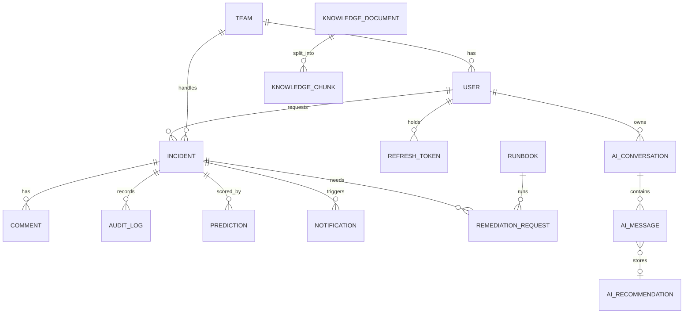
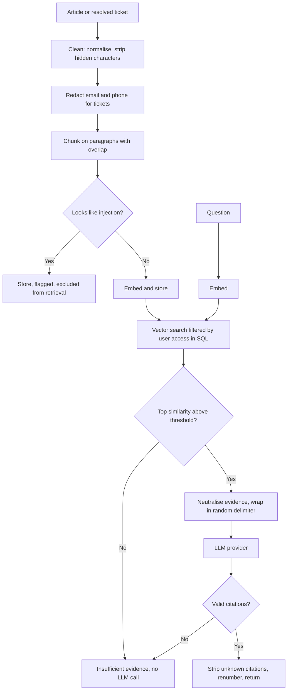

# Architecture

## Layers

| Layer | Location | Responsibility |
| --- | --- | --- |
| HTTP | `app/api/` | Routing, validation, authentication, rate limits. No business rules. |
| Services | `app/services/` | Business rules and authorization, shared with Celery. |
| ML | `app/ml/` | Training, registry and inference. No database access. |
| RAG | `app/rag/` | Ingestion, retrieval, safety filters, generation and evaluation. |
| Workers | `app/workers/` | Task definitions and schedule. They call services. |
| Data | `app/models/`, `alembic/` | Schema and migrations. |

The API and workers share one service layer, so a rule such as "breaches escalate once" exists in one place.

## Data model

Notes on the schema:

- `incidents.priority` is derived from impact and urgency and cannot be set directly.
- `predictions` stores every model output with its version, plus whether a person accepted it. Live acceptance rates come from here.
- `audit_logs` rejects `UPDATE` and `DELETE` through a trigger, so even a code bug cannot rewrite history.
- `knowledge_chunks.embedding` is a 384-dimension vector with an HNSW cosine index.
- `notifications` has a partial unique index on `(user_id, dedupe_key)`, which makes scheduled alerts idempotent.

## Access model

| Capability | Requester | Agent | Manager | Admin |
| --- | --- | --- | --- | --- |
| Raise incidents, comment, use the assistant | Yes | Yes | Yes | Yes |
| View incidents | Own | Own team, unrouted, or assigned | All | All |
| Internal notes, AI panels, audit history | No | Yes | Yes | Yes |
| Change status, assign, escalate | No | Own scope | Yes | Yes |
| Assign to someone else | No | No | Yes | Yes |
| Request remediation | No | Yes | Yes | Yes |
| Approve remediation | No | No | Yes, not own | Yes, not own |
| Dashboard | No | No | Yes | Yes |
| Add knowledge | No | No | Yes | Yes |
| Delete knowledge, manage users | No | No | No | Yes |

| Document access | Requester | Agent | Manager and Admin |
| --- | --- | --- | --- |
| Public | Yes | Yes | Yes |
| Internal | No | Yes | Yes |
| Restricted | No | Owning team only | Yes |

Authorization is enforced in `services/access.py`. The frontend only hides navigation. Incidents a user cannot see return 404 rather than 403, so ids cannot be probed.

## Authentication

- Passwords use Argon2id. Unknown emails still run a verification, so timing does not reveal valid accounts.
- Access tokens are short-lived JWTs held in memory by the browser, with signature, expiry, issuer and audience all checked. The role is read from the database on each request, so a demotion applies immediately.
- Refresh tokens live in an `httpOnly`, `SameSite=Strict` cookie, are stored hashed, and rotate on each use. Replaying an old one revokes the whole session family.
- Login is limited to 10 attempts a minute per address. Refresh has a separate, higher limit, because every page load uses it.

## RAG pipeline

Prompt injection is handled in layers, because no single filter is reliable:

1. **Quarantine at ingestion.** Instruction-like chunks are flagged and never retrieved. Hidden Unicode characters are removed first.
2. **Neutralising evidence.** Angle brackets and citation-like text are rewritten, so a document cannot close its block or forge a source.
3. **Random delimiter.** The evidence tag is generated per request, so it cannot be guessed in advance.
4. **System rules.** Evidence is declared to be data, not instructions.
5. **Output validation.** Citations to unknown sources are removed, and an answer with no valid citation becomes a refusal.
6. **No tools.** The LLM produces text only. Even if every other layer failed, the worst outcome is a bad suggestion that a person reads.

Answers render as plain text, never HTML, because they derive from documents.

## Automation

| Job | Schedule | Purpose |
| --- | --- | --- |
| `check_sla` | Every minute | Mark breaches, escalate, alert on overdue responses and high predicted risk |
| `rescore_open_incidents` | Every 15 minutes | Refresh risk scores as backlogs change |
| `reconcile_resolved_incidents` | Hourly | Index tickets whose task was lost in a broker outage |
| `auto_close_resolved` | Hourly | Close tickets resolved over 7 days ago |
| `index_resolved_incident` | On resolve | Add the ticket to the knowledge base |
| `execute_remediation` | On approval | Run the approved runbook once |
| `send_notification_email` | On notification | Send email when SMTP is configured |

Tasks can run twice, because acknowledgement is late and a worker can die between finishing and acknowledging, so each one is idempotent. Tasks are queued after commit, so a worker never sees uncommitted data and a rolled-back transaction queues nothing. If the broker is down, the request still succeeds and the reconciliation job catches up.

## Model registry

Artifacts are stored as `artifacts/<kind>/<version>/model.joblib` with metadata recording the data hash, seed, metrics, comparison and library versions. `joblib` files execute code when loaded, so each load verifies a SHA-256 checksum first.

If a model is missing or fails, incidents are still created and simply stay untriaged. `/ready` reports which versions are loaded.

## Tradeoffs

| Decision | Reason | Cost |
| --- | --- | --- |
| Sync SQLAlchemy | One session pattern for API and workers | Lower peak concurrency than async |
| Inference inside the request | TF-IDF models answer in milliseconds | Models load in the API process |
| File-based model registry | No extra service to run | No web UI, and a shared volume between containers |
| Extractive default | The demo works with no model and cannot invent facts | Answers are quoted sentences, not prose |
| Monolith with Celery | Right size for this scope | Scaling is by process, not by service |
| HNSW index | Fast approximate search | Slower writes, which suits a small corpus |
